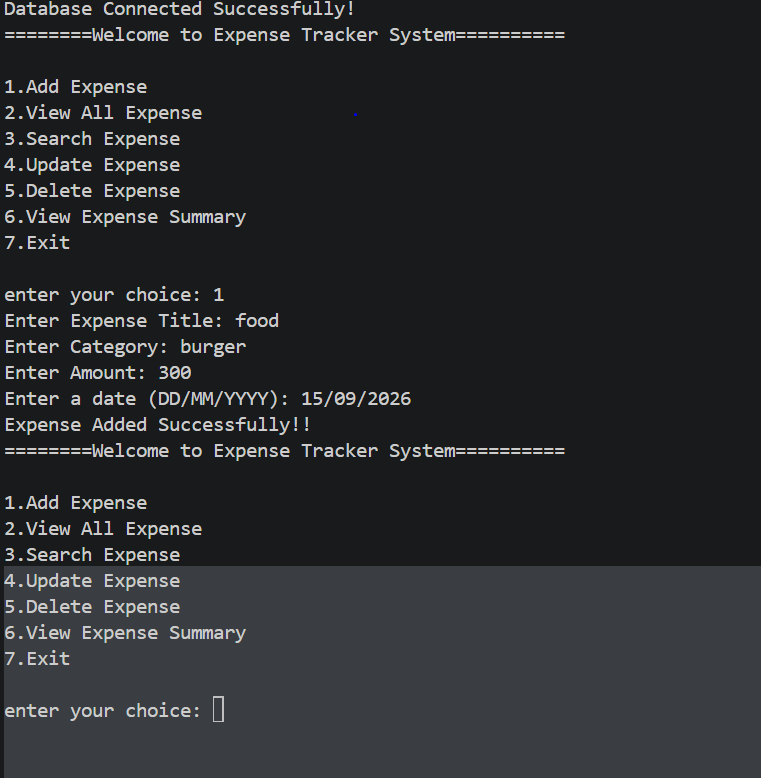
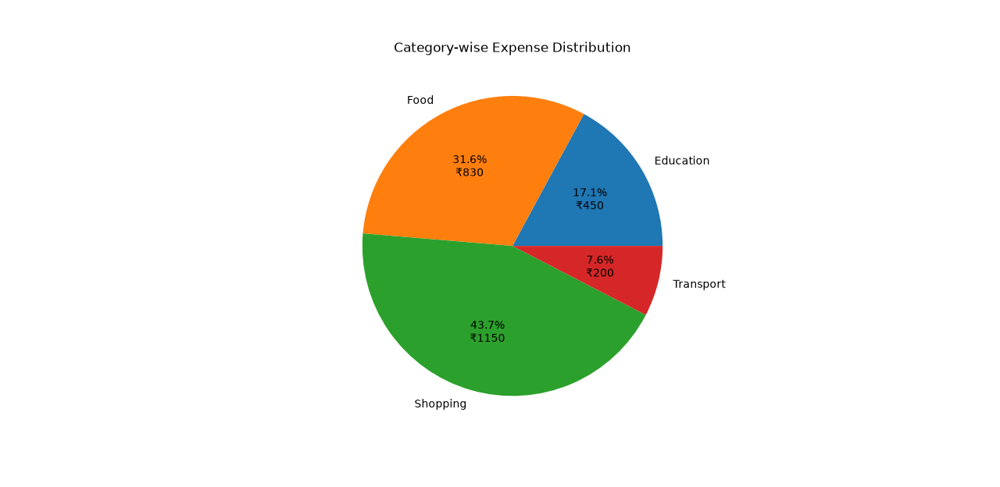
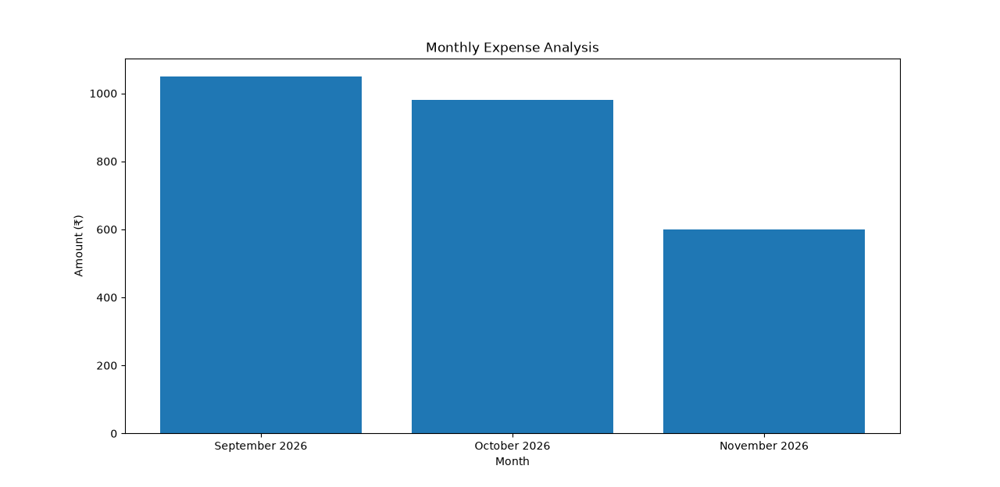
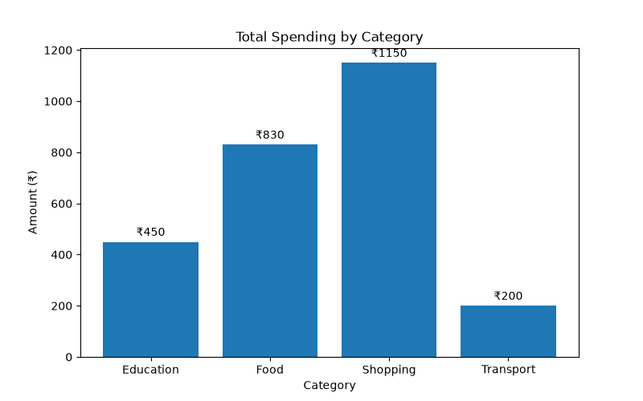

# Personal Expense Tracker

A Python-based application that helps users manage their daily expenses, store expense records in a MySQL database, and analyze spending patterns using Pandas and Matplotlib.

## Features

- Add new expenses
- View all expense records
- Search expenses
- Update existing expenses
- Delete expenses
- Calculate total, average, highest and lowest expenses
- Analyze category-wise spending
- Analyze monthly expenses
- Generate bar charts and pie charts for expense visualization

## Technologies Used

- Python
- MySQL
- Pandas
- Matplotlib
- MySQL Connector

## Project Structure

```text
ExpenseTracker/
│
├── analysis.py
├── database.py
├── expense.py
├── main.py
├── requirements.txt
├── .gitignore
└── README.md
```

## Installation and Setup

### 1. Clone the repository

```bash
git clone YOUR_GITHUB_REPOSITORY_URL
```

### 2. Install required libraries

```bash
pip install -r requirements.txt
```

### 3. Create the MySQL database

```sql
CREATE DATABASE expense_tracker;
```

Create the `expenses` table using the table structure defined in the project code.

### 4. Configure the database password

Set the `DB_PASSWORD` environment variable to your MySQL password.

For Windows PowerShell:

```powershell
$env:DB_PASSWORD="your_mysql_password"
```

### 5. Run the application

```bash
python main.py
```

## Data Analysis and Visualization

The project uses Pandas for expense analysis and Matplotlib for graphical representation.

The visualizations include:
- Category-wise spending bar chart
- Category-wise expense distribution pie chart
- Monthly expense bar chart

## Screenshots

### Expense Tracker Output


### Category-wise Expense Distribution


### Monthly Expense Analysis


### Total Spending by Category



## Author

Apeksha Shinde

MCA Student | Python | MySQL | Data Analysis